Lab: AUP-ZU3 Memory Mapped IO (s_axilite)
=========================================

This is the AUP-ZU3 version of :doc:`PYNQ-example`, using the same Lab 1 C++ source in ``project_files/lab1``.
We build the function :math:`f(x) = 2x` as an AXI-Lite accelerator, connect it to the ARM processing system, generate a bitstream, and prepare a PYNQ notebook to call it.
The screenshots were captured from a real Vivado 2024.1 GUI on the remote desktop.
The course boards are the **4 GB** AUP-ZU3; every step below assumes that board.
The overlay and notebook code have been run on a 4 GB AUP-ZU3 with the PYNQ 3.1.1 image.
To set up the board itself (SD card image, cables, Jupyter), see :ref:`zu3-board-setup`.

0) Build tools setup
--------------------

Install Vivado and Vitis with support for Zynq UltraScale+ MPSoC devices, or use the course's existing installation.
See the installation resources in :doc:`PYNQ-example` for the general tool setup.
This walkthrough uses version 2024.1 and the ``xczu3eg-sfvc784-2-e`` device.

If you do not already have the build environment, create it once with Conda::

  conda create -n pp4fpga python=3.11 numpy=1.26 zlib

On waiter, activate the Python environment and source both tool settings before running Make::

  source ~/.bashrc
  conda activate pp4fpga
  source /tools/Xilinx/Vivado/2024.1/settings64.sh
  source /tools/Xilinx/Vitis_HLS/2024.1/settings64.sh
  cd ~/scratch/Read_the_docs/project_files/lab1
  command -v python3 vitis-run vivado

If your account has the ``x24`` alias, you can use it to source both settings scripts.

On another machine, use the corresponding settings scripts for your installation.
A working Python 3 executable must be on ``PATH``.
The ``pp4fpga`` environment is for building on the host; the notebook runs in the board's PYNQ Python environment.

.. _zu3-board-presets:

Board presets
~~~~~~~~~~~~~

The course boards use the 4 GB preset ``realdigital.org:aup-zu3-4gb:part0:1.0``, which is the Make default.
Vivado also lists an 8 GB preset; do not select it, because its processing-system and DDR settings do not match the 4 GB board.

HLS synthesis and IP export only need the FPGA device support installed with the AMD tools.
Bitstream generation also needs the board preset to configure the processing system and DDR correctly.
The Make flow checks Vivado for the requested preset first.
If it is missing, it downloads the `Real Digital board files <https://github.com/RealDigitalOrg/aup-zu3-bsp/tree/master/board-files>`_ into the gitignored ``board_files/`` directory and registers them for that build.
Run this once before the manual GUI walkthrough to prepare the IP and, if necessary, the board files::

  make block-design TARGET=zu3

If Make downloaded the presets, start the GUI from ``project_files/lab1`` and enter the following in its Tcl Console before opening the New Project wizard::

  set board_repo [file normalize ../../board_files/aup-zu3-bsp/board-files]
  set_param board.repoPaths [concat [get_param board.repoPaths] [list $board_repo]]
  get_board_parts *aup-zu3*

If your board files are installed elsewhere, use that directory instead.
Confirm that the selected board identifier appears in the output.
The build uses a shallow, sparse checkout and reuses cached board files without fetching updates.
Git and network access are needed for the first download when neither an installed preset nor cached files are available.
Later builds can reuse the cache offline.
Use ``BOARD_CACHE=/absolute/path`` to change the cache location.

For custom or manually downloaded board definitions, pass ``BOARD_REPO=/absolute/path/board-files``.
This path is added to Vivado's existing board repositories.
With an explicit ``BOARD_REPO``, the requested preset must be available there or already installed; the build does not download a replacement repository.
Use ``BOARD_PART=<vendor>:<board>:part0:<version>`` if your preset has a different identifier.

Working through SSH and RDP
~~~~~~~~~~~~~~~~~~~~~~~~~~~

The build can run in an SSH terminal while Vivado opens on your remote desktop.
On waiter, the desktop used for these screenshots was ``:11.0``::

  export DISPLAY=:11.0
  export XAUTHORITY="$HOME/.Xauthority"
  vivado -mode gui

Use the ``DISPLAY`` value from a terminal inside your own RDP desktop; it can change between sessions.
Keep that desktop unlocked while following the GUI steps.
No second VS Code installation is needed on the desktop.

1) Vitis HLS: C/C++ to RTL
--------------------------

The source files are the same as in the PYNQ-Z2 lab:

* ``mul.cpp`` implements ``*out = 2 * in``.
* ``mul.h`` defines ``data_t`` as a signed C ``int``.
* ``mul_test.cpp`` is the C++ testbench.
* ``__hls_config__.ini`` selects the top function and a 10 ns clock period.
* ``Makefile`` selects the FPGA part through ``TARGET``.

The existing interface pragmas expose the arguments and control registers on AXI-Lite:

.. code-block:: c++

   #pragma HLS INTERFACE mode=s_axilite port=return
   #pragma HLS INTERFACE mode=s_axilite port=in
   #pragma HLS INTERFACE mode=s_axilite port=out

Synthesize the accelerator and export the IP::

  make report TARGET=zu3
  make ip TARGET=zu3

The component is ``mul_zu3.comp`` and the exported repository is::

  mul_zu3.comp/hls/impl/ip/

The IP archive is ``mul_zu3.comp/hls/impl/ip/xilinx_com_hls_mul_1_0.zip``.
Use the extracted repository directory in Vivado.
``TARGET=zu3`` overrides the PYNQ device in the configuration file and keeps the ZU3 output separate from ``mul.comp``.

2) Vivado: RTL to bitstream
---------------------------

You can build the complete overlay directly from the terminal::

  make bitstream TARGET=zu3

This writes matching ``build/zu3/mul.bit`` and ``build/zu3/mul.hwh`` files.
To inspect this generated project, open ``build/zu3/vivado/overlay.xpr`` in Vivado.

The following GUI walkthrough covers the same stages as the PYNQ-Z2 lab.
It uses a separate project named ``lab1_zu3`` under ``build/zu3_gui`` so it can be followed alongside the Make build.

2.1) Create a new project
~~~~~~~~~~~~~~~~~~~~~~~~~

Choose **File > Project > New** and click **Next**.

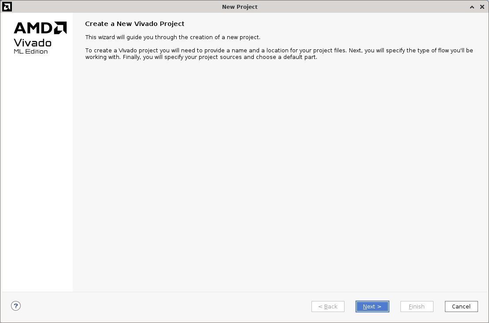

   Start a new Vivado project.

Name the project ``lab1_zu3`` and choose ``project_files/lab1/build/zu3_gui`` as the project location.
Leave **Create project subdirectory** selected.

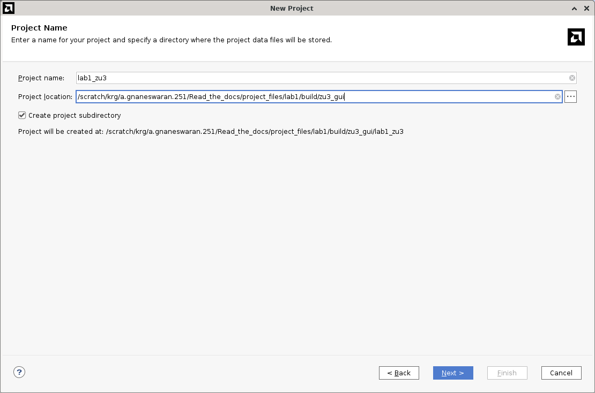

   Keep the manual project separate from the Make-generated project.

Select **RTL Project** and check **Do not specify sources at this time**.
The HLS IP will be imported after the project is created.

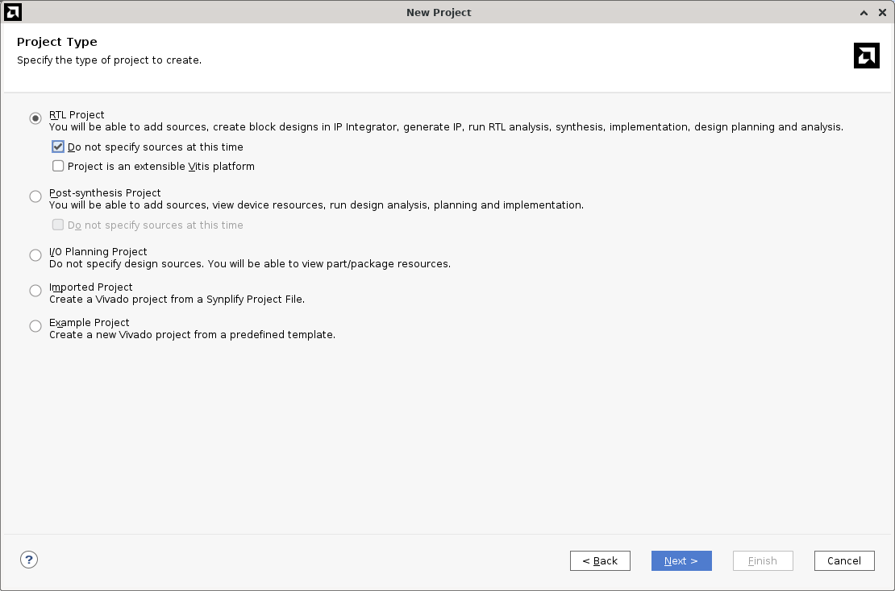

   Create an RTL project without adding source files yet.

On the **Default Part** page, switch to **Boards** and choose **Zynq UltraScale+ AUP-ZU3 4GB Development Board** (not the 8GB entry).
Confirm the device is ``xczu3eg-sfvc784-2-e``.

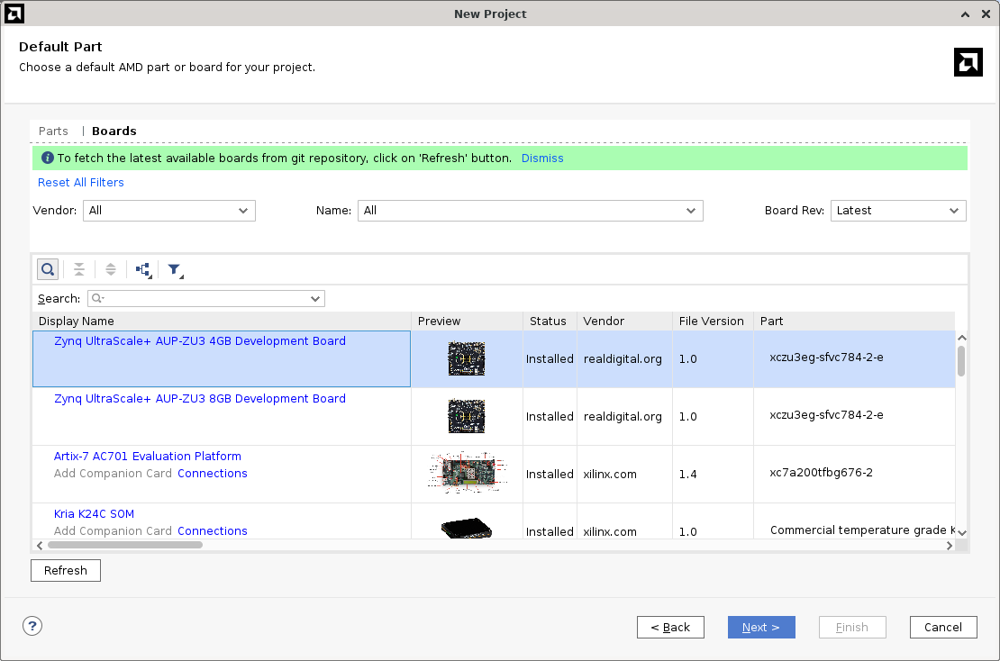

   Select the 4 GB board preset.

Click **Next**, check the project summary, and click **Finish**.

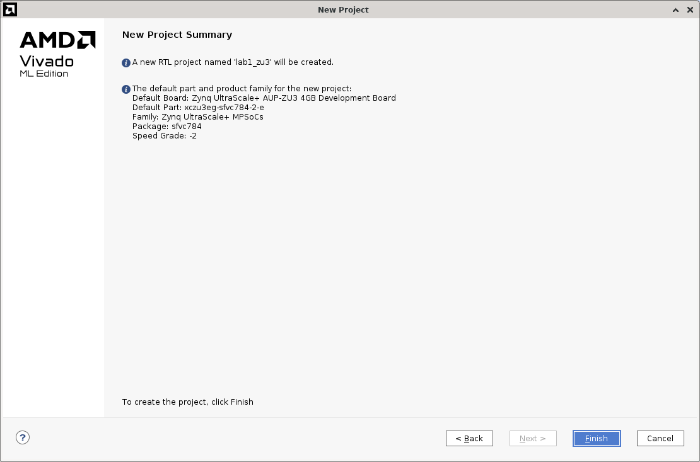

   Verify the board and FPGA part before creating the project.

Choose **Create Block Design** in the Flow Navigator.
Keep the design name ``design_1`` and click **OK**.

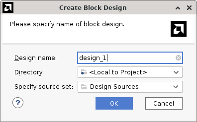

   Create the block design that will contain the accelerator and processing system.

2.2) Import the HLS IP
~~~~~~~~~~~~~~~~~~~~~~

Open **Settings > IP > Repository**, click **+**, and select the absolute path to ``mul_zu3.comp/hls/impl/ip``.
Vivado should report one repository with one IP.
Confirm the dialog and click **OK** to apply the settings.

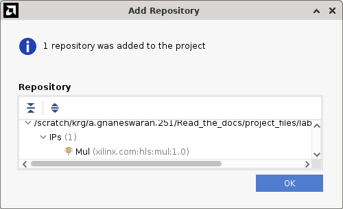

   Register the exported HLS IP repository.

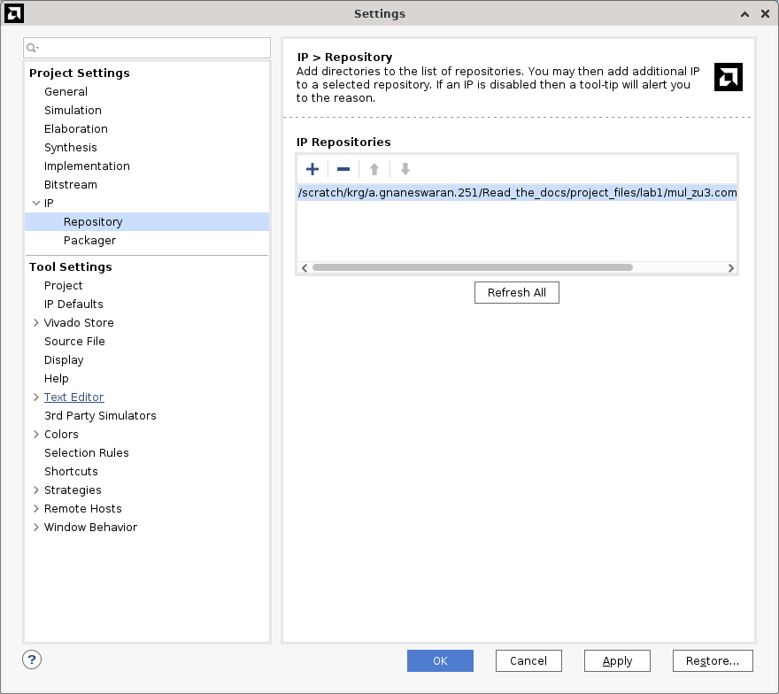

   The repository path points to the ZU3 HLS component.

Open **IP Catalog** and search for ``mul``.
Your HLS accelerator appears as **Mul** under the user repository.

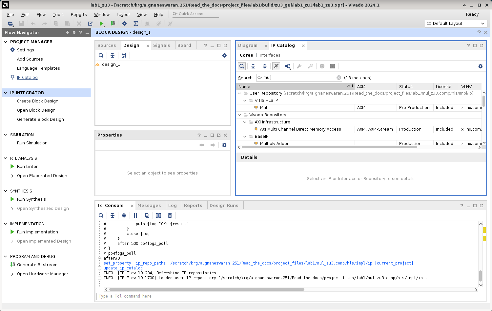

   Find the HLS accelerator in the catalog.

Return to the **Diagram** tab, click **+**, search for ``mul``, and select **Mul**.

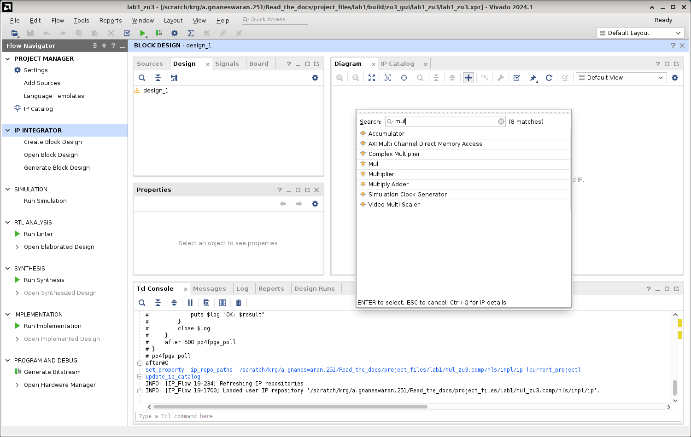

   Add the HLS Mul accelerator to the block design.

The new block is named ``mul_0``.
It exposes ``s_axi_control``, ``ap_clk``, ``ap_rst_n``, and ``interrupt``.
This lab polls completion, so the interrupt will be left unconnected.

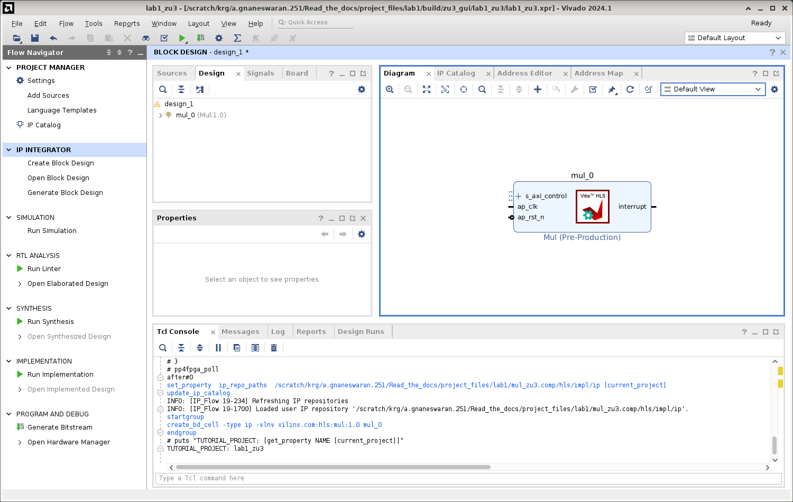

   The accelerator's AXI-Lite interface carries its arguments and control registers.

2.3) Connect the processing system
~~~~~~~~~~~~~~~~~~~~~~~~~~~~~~~~~~

Click **+** again, search for ``zynq``, and add **Zynq UltraScale+ MPSoC**.
This is the processing-system IP for AUP-ZU3.

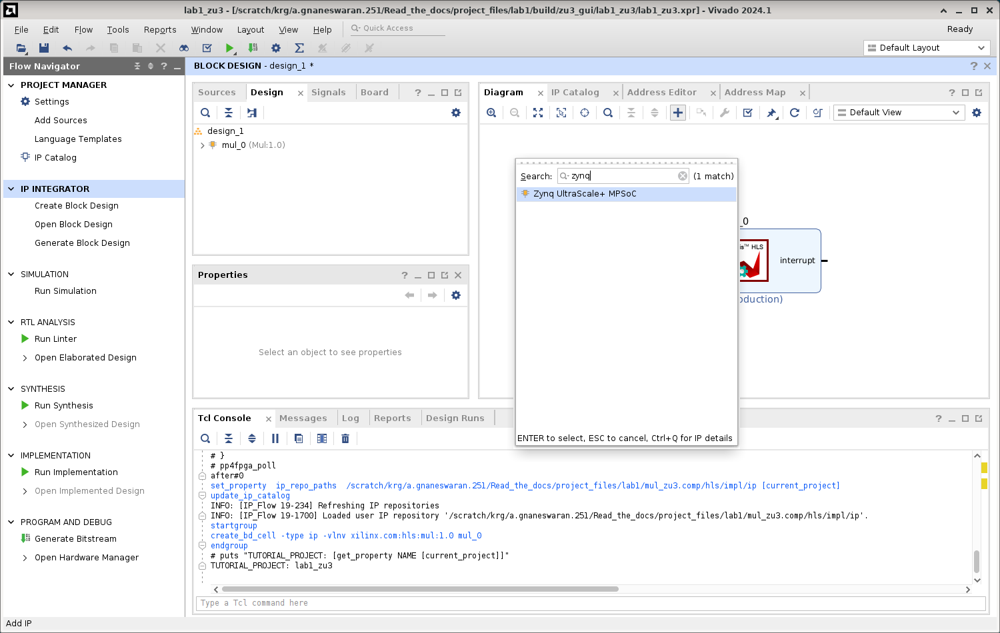

   Add the UltraScale+ processing system.

Use **Zoom Fit** if the new block extends beyond the diagram view.
At this stage the processing system and accelerator are unconnected.

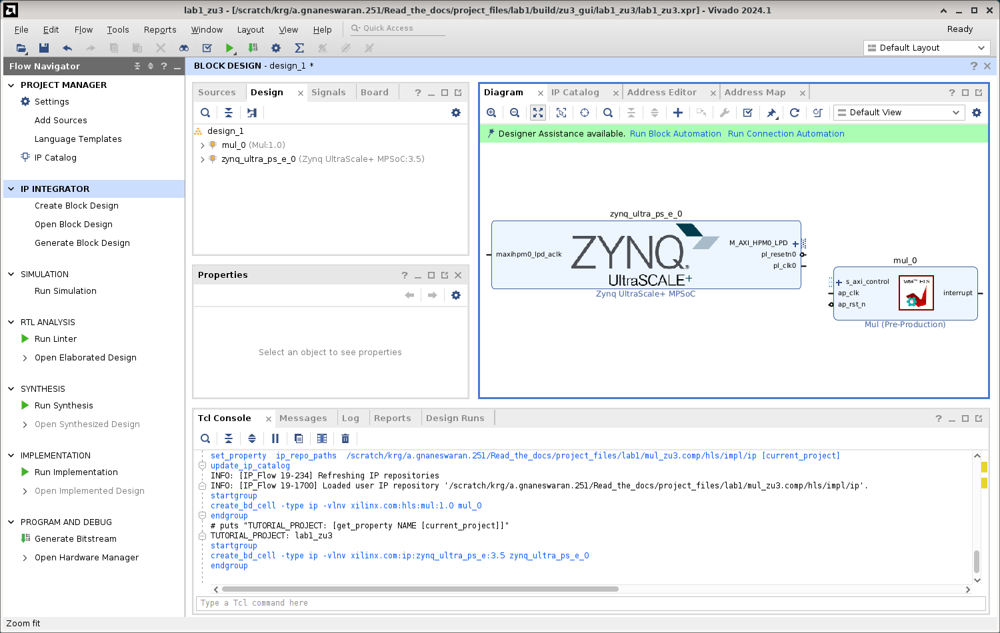

   The design needs AXI, clock, and reset connections.

Click **Run Block Automation**, select ``zynq_ultra_ps_e_0``, and leave **Apply Board Preset** checked.
Click **OK**.
This applies the AUP-ZU3 DDR and peripheral configuration.

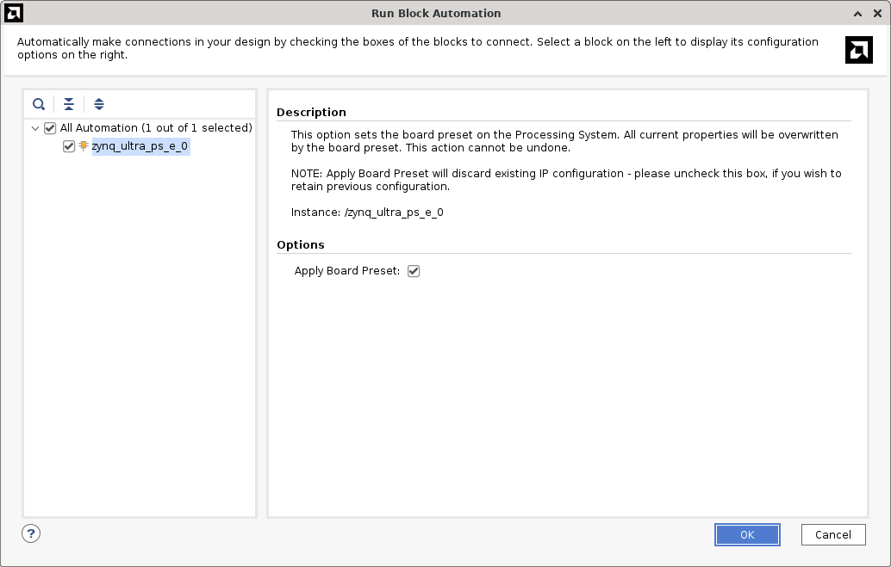

   Apply the selected board's processing-system preset.

Click **Run Connection Automation** and select ``mul_0/s_axi_control``.
The master interface should be ``/zynq_ultra_ps_e_0/M_AXI_HPM0_LPD`` with a new AXI interconnect.
Leave the clock choices at **Auto** for this preset and click **OK**.

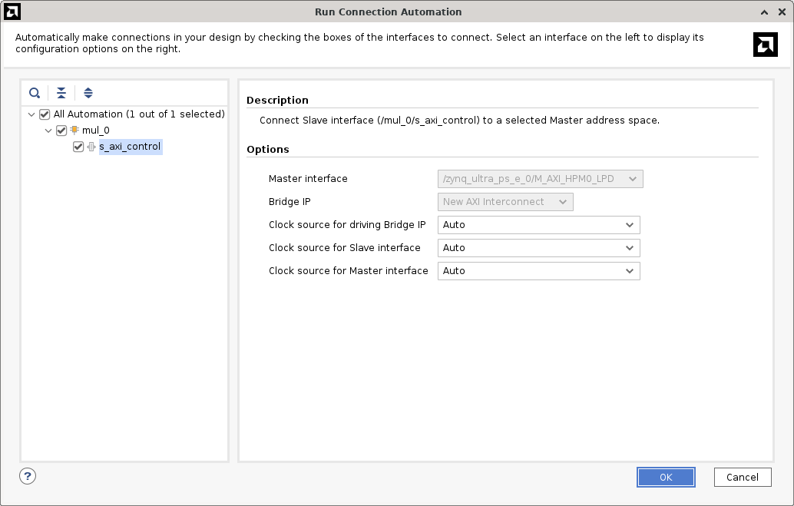

   Connect the processor's AXI master to the HLS control interface.

Vivado inserts ``ps8_0_axi_periph`` and a processor-system reset block.
Check that ``pl_clk0`` drives the accelerator's ``ap_clk``, the AXI interconnect clocks, ``maxihpm0_lpd_aclk``, and the reset block's ``slowest_sync_clk``.
Check that ``peripheral_aresetn`` drives ``mul_0/ap_rst_n`` and the interconnect's peripheral reset inputs.
The board preset requests 100 MHz; Vivado may name the automatically generated reset block ``rst_ps8_0_99M`` because the derived frequency is just below 100 MHz.

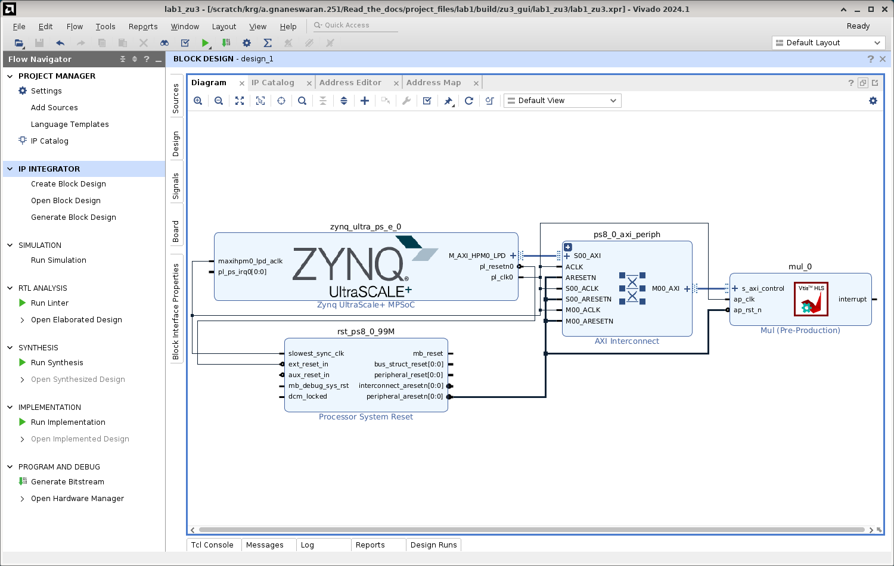

   The completed AXI-Lite system after connection automation.

Click **Validate Design** (or press **F6**) and save the block design.
Resolve any validation errors before continuing.
The Make-generated project uses the same PS AXI master and clock, with explicit wiring and slightly different interconnect/reset instance names.

2.4) Create the wrapper and generate the bitstream
~~~~~~~~~~~~~~~~~~~~~~~~~~~~~~~~~~~~~~~~~~~~~~~~~~

In **Sources**, expand **Design Sources**, right-click ``design_1``, and choose **Create HDL Wrapper**.

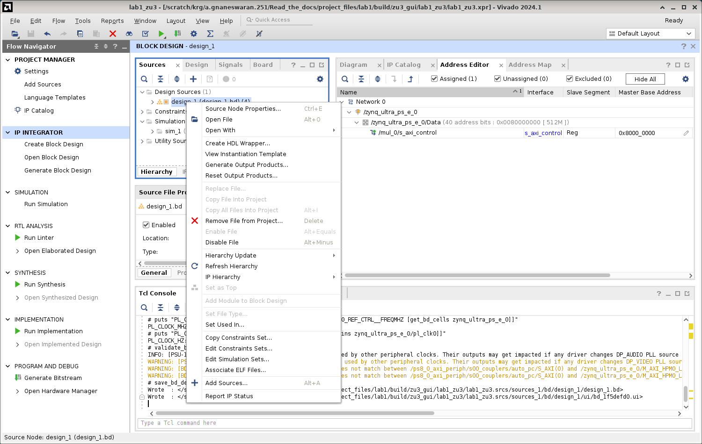

   Wrap the block design in a top-level HDL module.

Select **Let Vivado manage wrapper and auto-update**, then click **OK**.
Confirm that ``design_1_wrapper`` becomes the top module.

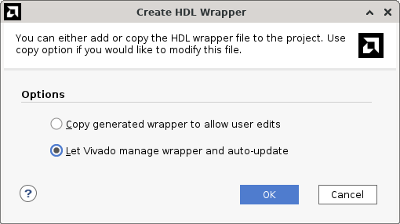

   Let Vivado regenerate the wrapper when the block design changes.

Click **Generate Bitstream** in the Flow Navigator.
Allow Vivado to run synthesis and implementation when prompted, choose the job count, and click **OK**.

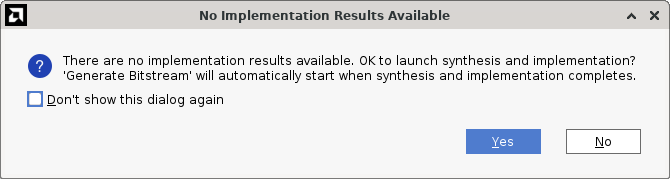

   Allow Vivado to run the prerequisite stages.

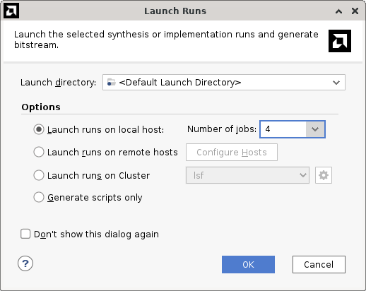

   Start the synthesis, implementation, and bitstream flow.

Wait for **write_bitstream Complete**.

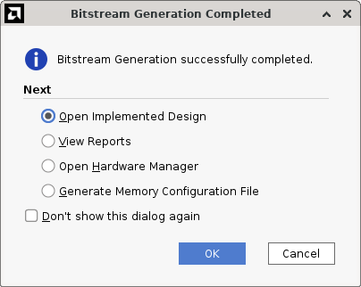

   Vivado reports successful bitstream generation.

Inspect the **Design Runs** tab and the implementation timing report.
Successful bitstream generation and timing closure are desktop checks; the board-side checks come later.

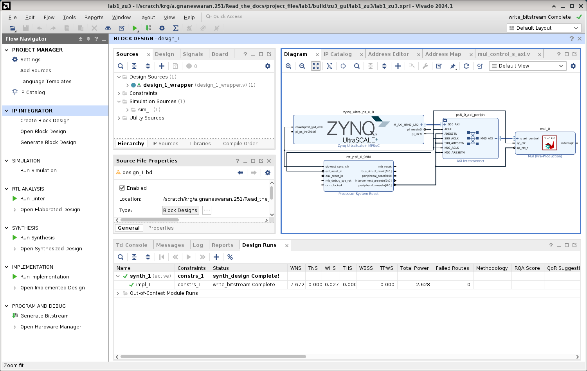

   The captured run has 7.672 ns setup slack and no failing timing endpoints.

2.5) Find the register addresses and overlay files
~~~~~~~~~~~~~~~~~~~~~~~~~~~~~~~~~~~~~~~~~~~~~~~~~~

The generated AXI-Lite source is::

  mul_zu3.comp/hls/impl/ip/hdl/verilog/mul_control_s_axi.v

You can also read the C driver header::

  mul_zu3.comp/hls/impl/ip/drivers/mul_v1_0/src/xmul_hw.h

These files list register offsets relative to the accelerator's base address.

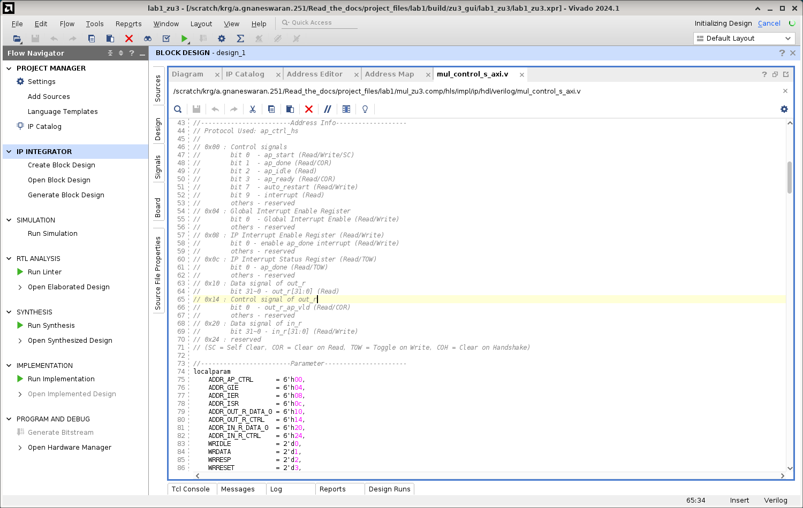

   Read the offsets from the generated IP rather than guessing them.

.. list-table:: Registers used by this lab
   :header-rows: 1
   :widths: 20 25 55

   * - Offset
     - Register
     - Purpose
   * - ``0x00``
     - Control
     - Write bit 0 (AP_START); poll bit 1 (AP_DONE).
   * - ``0x10``
     - ``out_r``
     - Read the signed 32-bit result.
   * - ``0x14``
     - ``out_r_ctrl``
     - Bit 0 indicates a valid output and clears when read.
   * - ``0x20``
     - ``in_r``
     - Write the signed 32-bit input.

Open **Address Editor** to see where the IP is mapped in the processor's address space.
The captured design assigns ``mul_0/s_axi_control`` a 64 KB range beginning at ``0x80000000``.
PYNQ reads the actual base address from the HWH file.

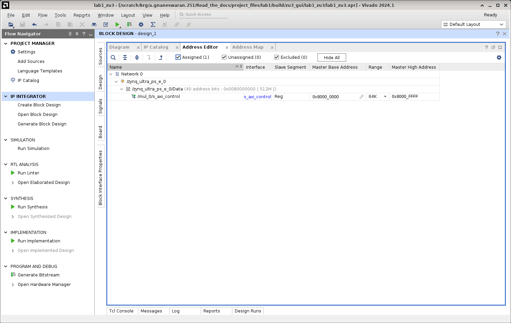

   The processor's base address is separate from the register offsets above.

For the Make build, the overlay files are already copied and renamed::

  build/zu3/mul.bit
  build/zu3/mul.hwh

For the manual project shown here, copy and rename both files from that project::

  cp build/zu3_gui/lab1_zu3/lab1_zu3.runs/impl_1/design_1_wrapper.bit build/zu3_gui/mul.bit
  cp build/zu3_gui/lab1_zu3/lab1_zu3.gen/sources_1/bd/design_1/hw_handoff/design_1.hwh build/zu3_gui/mul.hwh

Keep the bitstream and HWH from the same build, with identical basenames.
The `PYNQ Overlay documentation <https://pynq.readthedocs.io/en/v3.1/pynq_libraries/overlay.html>`_ describes how the HWH supplies IP metadata and clock settings when the overlay is loaded.

.. _zu3-board-setup:

3) AUP-ZU3 board and host
-------------------------

3.1) Set up the board
~~~~~~~~~~~~~~~~~~~~~

You need:

* the 4 GB AUP-ZU3 board and a USB-C power adapter that supports USB Power Delivery at 9 V / 3 A (the 45 W adapter from the board kit works);
* a microSD card of 16 GB or larger;
* a USB cable from your computer to the board's USB-C port (USB-C to USB-C, or USB-A to USB-C).

**Download the image.**
Download the `PYNQ 3.1.1 image for the 4 GB AUP-ZU3 <https://df5xthistukvx.cloudfront.net/AUP-ZU3-3.1.1-4GB-21Apr2026.tar.gz>`_ (about 2.2 GB).
It is listed as "PYNQ for ZU3 V4 boards - 4G" on `Real Digital's AUP-ZU3 page <https://www.realdigital.org/hardware/aup-zu3>`_; get it from there if the direct link stops working.
Do not use an 8 GB image on the course boards.

**Write the image to the microSD card.**
The download is a compressed archive, not the card image itself.
Extract the image file from it; the ``tar`` command is built into Windows 10/11, macOS, and Linux::

  tar -xzf AUP-ZU3-3.1.1-4GB-21Apr2026.tar.gz AUP-ZU3-3.1.1-4gb.img

This produces ``AUP-ZU3-3.1.1-4gb.img`` (about 9.8 GB).
The archive also contains a ``boot/`` folder, which you do not need.
Write the ``.img`` file to the microSD card with `balenaEtcher <https://etcher.balena.io/>`_ or another disk-image writer.
Writing erases the card, so double-check that you selected the microSD card and not another drive.
Afterwards, Windows may say the card must be formatted before it can be used; click **Cancel**, because formatting would erase the image.

**Connect the board.**
The connectors used here are along the top edge of the board:

.. list-table::
   :header-rows: 1
   :widths: 30 70

   * - Connector (board label)
     - Use
   * - **EXT PWR** (USB-C, top right)
     - Power adapter.
   * - **USB 3.0 DRP** (two USB-C ports, top left, next to the Mini DisplayPort)
     - Your computer. PYNQ makes the board appear as a USB network adapter, which is how you reach Jupyter.
   * - **PROG UART** (USB-C, between the DRP ports and the SD slot)
     - Optional: serial console (115200 baud) and JTAG for Vivado. It does **not** give you Jupyter.

#. Set the **BOOT** switch, next to the microSD slot, to **SD**.
#. Insert the microSD card.
#. Connect one of the **USB 3.0 DRP** ports to your computer.
#. Connect the power adapter to **EXT PWR**.
#. Turn on the power switch in the top-right corner.

The **ON** LED and two PS LEDs light immediately, and one PS LED blinks in a heartbeat pattern.
After about 30-60 seconds the **DONE** LED turns on, and a few seconds later the user and RGB LEDs flash.
The board is then ready.

**Open Jupyter.**
On Windows and Linux, the board appears as a new USB network adapter on your computer.
On macOS, complete section 3.2 first.
Open ``http://192.168.3.1/lab`` in Chrome, Firefox, or Edge and log in with the password ``xilinx``.
If the page does not load, wait another minute, then try the other USB 3.0 DRP port.
If you connect the board through a different network instead, use the board's assigned address.

For more detail, see the `official AUP-ZU3 getting-started guide <https://xilinx.github.io/AUP-ZU3/getting_started.html>`_.

3.2) macOS USB networking with PYNQ 3.1
~~~~~~~~~~~~~~~~~~~~~~~~~~~~~~~~~~~~~~~

The original course guide reports that the PYNQ 3.1 image's default RNDIS USB networking does not work with macOS.
Its workaround enables ECM networking by removing the image's ``delete-for-mac.txt`` marker file.
These instructions apply to that image; other image versions may configure USB networking differently.

UCSD students can also use the `course's preconfigured macOS image <https://ucsdcloud-my.sharepoint.com/:u:/g/personal/dzuberi_ucsd_edu/IQAARi9ywb8WTrAAlJoqZtc_AbtKFOAoWkFD-KTOM-npeyA?e=ua6UA5>`_, which already includes this change.
That image is compressed with zstd, supports microSD cards of at least 16 GB, and expands to fill the card on boot.
Decompress it with zstd before writing the image to the card.
If you use the standard PYNQ 3.1 image instead, perform the following steps.

Write the image to the card, boot the board, and connect a USB-C cable between the Mac and the board's **PROG UART** port.
List the serial devices on the Mac::

  ls /dev/tty*

For example, the original guide saw these two entries::

  /dev/tty.usbserial-8800204102EB0
  /dev/tty.usbserial-8800204102EB1

Your device names will differ.
Compare the list with the board disconnected and reconnected to identify its ports.
The original setup used the port ending in ``1`` for the UART console.
Open the corresponding ``/dev/cu.*`` device with GNU screen at 115200 baud::

  screen /dev/cu.usbserial-8800204102EB1 115200

Press Enter to display the board's shell prompt, or wait for boot to finish.
Run the following commands in the board's shell::

  mkdir -p /tmp/fatfs
  sudo mount /usr/local/share/fatfs /tmp/fatfs
  sudo rm /tmp/fatfs/delete-for-mac.txt
  sudo reboot

For password prompts on the standard image, the default password is ``xilinx``.
After rebooting, use the board's **USB 3.0 DRP I** networking port to connect to the Mac and open Jupyter.

3.3) Inspect the USB networking configuration
~~~~~~~~~~~~~~~~~~~~~~~~~~~~~~~~~~~~~~~~~~~~~

This section is optional background; you do not need it to run the lab.
The original course guide found the macOS workaround by inspecting the board's USB gadget service and startup script.
On the board, inspect the service with::

  systemctl cat usbgadget

The PYNQ 3.1 service was configured as follows::

  # /lib/systemd/system/usbgadget.service
  [Unit]
  Description=USB Gadget for Networking
  Before=network-online.service isc-dhcp-server.service

  [Service]
  Type=oneshot
  RemainAfterExit=yes
  ExecStart=/usr/local/bin/usbgadget
  ExecStop=/usr/local/bin/usbgadget_stop

  [Install]
  WantedBy=basic.target

The ``/usr/local/bin/usbgadget`` script checks for ``delete-for-windows.txt`` and ``delete-for-mac.txt`` in the FAT filesystem when choosing RNDIS or ECM networking.
Inspect the service and script if you are adapting these steps to a different PYNQ image.

3.4) Run the Lab 1 notebook
~~~~~~~~~~~~~~~~~~~~~~~~~~~

Download :download:`the Lab 1 ZU3 notebook <../project_files/lab1/demo/mul_zu3.ipynb>`.
In Jupyter's file browser on the board, create a new folder (for example ``lab1``), open it, and use the **Upload** button to add ``mul_zu3.ipynb``, ``mul.bit``, and ``mul.hwh``.
All three files must be in the same folder.
Use either the Make-generated pair or the manual-project pair of ``mul.bit`` and ``mul.hwh``.
Open the notebook with the board's PYNQ Python kernel and run its cells in order.

The notebook loads the overlay, finds ``mul_0`` through the hardware metadata, and prints its register map:

.. code-block:: python

   from pynq import Overlay

   ol = Overlay("mul.bit")
   mul = ol.mul_0
   print(f"Base address: {ol.ip_dict['mul_0']['phys_addr']:#x}")
   print(mul.register_map)

The notebook's ``twice()`` helper writes the input, starts the accelerator, polls AP_DONE with a timeout, checks output validity, and converts the 32-bit result to a signed Python integer.
It includes assertions for positive, negative, zero, and boundary inputs that do not overflow the signed C ``int``.
For example:

.. code-block:: python

   result = twice(5)
   assert result == 10
   print(result)

The expected result is ``10``, and every value in the notebook's test list should print twice its input with no assertion errors.
Save the notebook with its real outputs after all assertions pass on your board.

4) Troubleshooting
-------------------

``vitis-run`` or ``python3`` is missing
~~~~~~~~~~~~~~~~~~~~~~~~~~~~~~~~~~~~~~~

Activate ``pp4fpga`` and source both tool settings in the same shell used for Make, as shown in section 0.
Check ``command -v python3 vitis-run vivado``.
On another host, source that host's tool settings and provide a Python 3 environment.

``libz.so.1`` is missing, followed by ``Unsupported architecture``
~~~~~~~~~~~~~~~~~~~~~~~~~~~~~~~~~~~~~~~~~~~~~~~~~~~~~~~~~~~~~~~~~~

On waiter, the ``pp4fpga`` activation hook adds the environment's library directory to ``LD_LIBRARY_PATH``.
Run ``conda activate pp4fpga`` before invoking the AMD tools.
For a newly created environment on waiter without that hook, activate it and add its runtime library directory in the build shell::

  conda activate pp4fpga
  export LD_LIBRARY_PATH="$CONDA_PREFIX/lib${LD_LIBRARY_PATH:+:$LD_LIBRARY_PATH}"

If the prepared environment was already active before the hook was installed, deactivate and reactivate it::

  conda deactivate
  conda activate pp4fpga
  ldd "$(command -v uname)"

The architecture message is a consequence of the launcher failing to run its host utilities.
Fix the missing runtime library first.

AUP-ZU3 is missing from the board selector
~~~~~~~~~~~~~~~~~~~~~~~~~~~~~~~~~~~~~~~~~~

Run ``make block-design TARGET=zu3`` and check whether the preset was downloaded into ``board_files/``.
Register the board repository in the GUI Tcl Console as shown in section 0, then reopen the wizard.
Select the 4 GB entry.
See :ref:`zu3-board-presets` for custom ``BOARD_REPO`` paths.

The notebook cannot find the IP, or a call times out
~~~~~~~~~~~~~~~~~~~~~~~~~~~~~~~~~~~~~~~~~~~~~~~~~~~~

Check that both overlay files came from the same successful ZU3 build and share the basename ``mul``.
Inspect ``ol.ip_dict`` and ``mul.register_map`` before accessing registers.
For a timeout, check the AXI master connection, PL clock, and reset in Vivado.
Reload the overlay before retrying after a timeout.

PS and PL
~~~~~~~~~~

The ARM processors and DDR belong to the processing system (PS).
The ``mul_0`` accelerator, AXI interconnect, and reset logic are implemented in the programmable logic (PL).
PYNQ runs Python on the PS and uses AXI-Lite register accesses to communicate with ``mul_0`` in the PL.
No DMA or PL data buffer is needed for this scalar example.

5) Build other course projects
-------------------------------

The AMD HLS labs and projects support ``TARGET=pynq`` (the default) and ``TARGET=zu3`` through the same Make targets.
The existing tutorial commands ``make test``, ``make hls``, ``make report``, ``make ip``, and ``make clean`` work without adding ``TARGET``.
They retain the PYNQ component, report, and IP export paths used by those tutorials.
Run them from the directory containing the project's Makefile::

  make hls                         # PYNQ-Z2 HLS synthesis
  make hls TARGET=zu3               # AUP-ZU3 HLS synthesis
  make report TARGET=zu3            # Synthesis report
  make ip TARGET=zu3                # Export Vivado IP
  make block-design TARGET=zu3      # Create and validate the Vivado design
  make bitstream TARGET=zu3         # Generate the bitstream and HWH

The FFT, OFDM, and BNN HLS folders have Makefile wrappers for their existing source files and directives.
For example, from the repository root::

  make -C project_files/project5_bnn/hls hls TARGET=zu3
  make -C project_files/lab1 bitstream TARGET=zu3

Source the AMD tool settings and ensure ``python3`` is on your PATH as described in section 0.
This shared flow uses Vitis Unified HLS commands and was developed with version 2024.1.
The Intel DPC++ examples use their own build flow.

Board selection chooses ``xc7z020clg400-1`` for PYNQ-Z2 and ``xczu3eg-sfvc784-2-e`` for AUP-ZU3.
PYNQ-Z2 uses ``<top>.comp`` and ``<top>.tcl``; AUP-ZU3 uses ``<top>_zu3.comp`` and ``<top>_zu3.tcl``.
This separates HLS outputs for the two FPGA parts.
The part in ``__hls_config__.ini`` remains the default for direct calls to the Tcl generator; Make overrides it through ``TARGET``.

The PYNQ-Z2 preset is ``tul.com.tw:pynq-z2:part0:1.0``.
If it is missing, the build downloads definitions from the `AMD board store <https://github.com/Xilinx/XilinxBoardStore/tree/master/boards/TUL/pynq-z2>`_ into ``board_files/XilinxBoardStore/boards/TUL``.
The ZU3 preset and cache options are described in :ref:`zu3-board-presets`.

5.1) Overlay interfaces and memory addresses
~~~~~~~~~~~~~~~~~~~~~~~~~~~~~~~~~~~~~~~~~~~~

``make bitstream`` exports the IP, creates the selected board's processing system, connects the accelerator, and runs Vivado implementation with a requested 100 MHz PL clock.
The resulting overlay files are ``build/<target>/<top>.bit`` and ``build/<target>/<top>.hwh``.
AUP-ZU3 runs PYNQ, so the existing ``pynq.Overlay`` API can load these files.
Use the generated HWH to find IP names and register offsets when adapting a notebook.

The supplied block-design template supports AXI-Lite control, AXI memory masters, and AXI streams with TLAST.
It sorts input and output streams separately by interface name and pairs them into simple-mode DMAs named ``axi_dma_0``, ``axi_dma_1``, and so on.
Each paired DMA has a send channel for its input stream and a receive channel for its output stream.
Unequal stream counts produce additional DMAs with only the required channel enabled.
The template uses polling for completion.

Student skeletons that expose plain scalar, array, or handshake ports need the interface pragmas from the relevant lab before generating an overlay.
HLS synthesis and IP export remain available for those skeletons.
The AXI burst lab uses 32-bit memory addresses on PYNQ-Z2 and the HLS default 64-bit addresses on AUP-ZU3.
On AUP-ZU3, write both halves of a 64-bit buffer address to the accelerator's pointer registers according to the generated register map.
The streaming template also configures 64-bit DMA addresses for AUP-ZU3.

5.2) Custom designs and build controls
~~~~~~~~~~~~~~~~~~~~~~~~~~~~~~~~~~~~~~

Pass ``BD_TCL=/absolute/path/design.tcl`` for an existing student block design or one needing custom peripherals.
This Tcl script runs after project creation and IP registration and must create a connected block design named ``design_1``.
It can use the supplied variables ``target``, ``part``, ``board_part``, ``top``, and ``ip_repo``.
Use ZYNQ7 Processing System on PYNQ-Z2 or Zynq UltraScale+ MPSoC on AUP-ZU3.

Use ``JOBS=<count>`` to change Vivado's parallel job count.
``make block-design TARGET=zu3`` stops after validation so you can inspect ``build/zu3/vivado/overlay.xpr`` before implementation.
``make clean-board TARGET=zu3`` removes the generated ZU3 Vivado output directory.
``make clean TARGET=zu3`` also removes the ZU3 HLS component and generated scripts, while preserving the PYNQ component and course Tcl sources.
